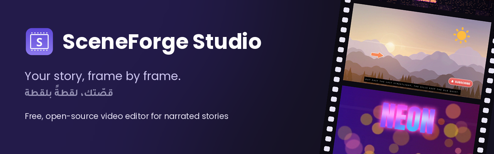
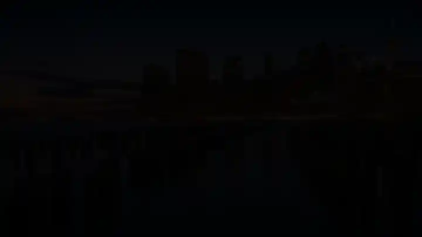
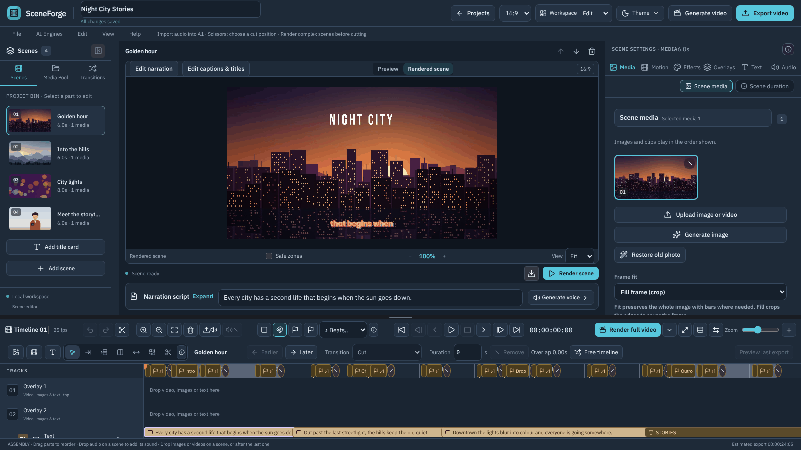

<p align="center">
  
</p>

<p align="center">
  <a href="https://github.com/EzioDEVio/SceneForge/releases"></a>
  <a href="https://github.com/EzioDEVio/SceneForge/releases"></a>
  <a href="https://github.com/EzioDEVio/SceneForge/actions/workflows/checks.yml"></a>
  <a href="LICENSE"></a>
  
</p>

<p align="center">
  <a href="#download"><b>Download</b></a> ·
  <a href="docs/FEATURES.md">Feature guide</a> ·
  <a href="docs/AI_PROVIDERS.md">AI options</a> ·
  <a href="docs/DEVELOPMENT.md">Build from source</a> ·
  <a href="docs/CHANGELOG.md">Changelog</a>
</p>

**SceneForge Studio turns a script, your photos and clips, and a voice into a finished, captioned video, one scene at a time.** Write the narration, drop in pictures, pick a look, and SceneForge times everything to the voice. It renders on your own computer with FFmpeg: no account, no watermark, no subscription. AI is optional, and much of it runs free on your machine. Arabic and English are first-class, right down to right-to-left captions.

<p align="center">
  
  <br><sub>Made in SceneForge from eight still photos: camera moves, whip pans, zoom punch, a before &amp; after reveal, spin and cinematic fades. Photos from Pixabay.</sub>
</p>

## Download

Get the installer for your system from **[Releases](https://github.com/EzioDEVio/SceneForge/releases)**. Releases marked *Pre-release* are betas with the newest features.

| System | File | First launch |
|---|---|---|
| **Windows 10/11** (64-bit) | `SceneForge-Studio-<version>-Windows-x64-Setup.exe` | Windows may say *"Windows protected your PC"*: click **More info → Run anyway**. SceneForge has no paid code-signing certificate yet. |
| **macOS** (Apple Silicon) | `.dmg` | Drag SceneForge to Applications, then right-click it and choose **Open** the first time. *macOS builds are experimental.* |
| **Linux** (64-bit) | `.AppImage` or `.deb` | AppImage: `chmod +x` and run it. Deb: `sudo apt install ./SceneForge-Studio-*.deb` |

SceneForge updates itself on Windows and Linux (AppImage); **Help → Receive beta updates** opts you in to betas. FFmpeg and everything else the editor needs are inside the installer.

## What's new in 0.9.4 (beta)

- **Trending effects** in *Effects → More effects → Trending*: beat zoom, flash, motion trails, mirror, RGB split, cinematic fade & zoom, intro moves, a before & after slider and speed blur.
- **Seven new transitions:** whip pans, spin, zoom punch, glitch, cinematic zoom fade, and before & after. Plus **Y2K, Cozy and Clean & bright** looks.
- **Free AI on your computer with one click:** Whisper captions, Kokoro and Chatterbox voices (Arabic included) and Stable Diffusion images install into SceneForge's own folder. No Docker, no admin rights, and your NVIDIA card is used when you have one.
- **Gemini voices:** 30 voices in 100+ languages with a free Google AI Studio key.
- **Easier editing:** insert a picture between two parts, a Blade that cuts parts, "What to do" hints on errors, and layouts that fit laptop screens.

The full list is in the [changelog](docs/CHANGELOG.md).

## A look inside



<table>
  <tr>
    <td width="50%"><br><b>Trending effects.</b> Before &amp; after reveals, beat-synced zooms, flashes, RGB split, intro moves and more, each with its own settings and an effect stack you can reorder.</td>
    <td width="50%"><br><b>71 caption styles.</b> Word-by-word timing, karaoke highlights and proper Arabic right-to-left layout, generated from the narration by local Whisper.</td>
  </tr>
  <tr>
    <td width="50%"><br><b>400 stickers and emoji</b>, textured titles, video inside text, picture-in-picture, map routes, and AI subject cutout that puts text behind a person.</td>
    <td width="50%"><br><b>Free AI on this computer.</b> One click installs captions, voices and image generation. Nothing is uploaded, and every model is optional.</td>
  </tr>
</table>

**Also inside:** a multitrack timeline with pro edit tools (ripple, roll, slip, slide, blade), script-to-scenes and project templates, beat markers and beat sync, keyframes, 35+ film looks and LUT import, AI voice isolation, silence and filler-word removal, auto-reframe to 9:16, GPU export, and exports for YouTube, Shorts/Reels/TikTok, Instagram, ProRes, GIF and SRT/VTT. See the **[feature guide](docs/FEATURES.md)**.

## AI is optional

You can make a complete video from your own photos, clips and recordings without any account. When you want AI, choose where it runs:

| For | Free, on your computer | Cloud, with your own key |
|---|---|---|
| Captions | Whisper | OpenAI Whisper, ElevenLabs Scribe |
| Narration | Kokoro, Chatterbox (Arabic + 22 languages), Voicebox | ElevenLabs, Gemini voices (free key), Together AI |
| Pictures | Stable Diffusion (one click) or your own AUTOMATIC1111 | OpenAI, Google Gemini, Cloudflare, Hugging Face |
| Video clips | ComfyUI workflows (LTX, Wan) | Google Veo, Runway |
| Voice isolation, subject cutout | Local models | — |

Paid requests show a cost estimate and need your confirmation first. Keys stay in your system's credential store, never in project files. Details, prices and download sizes are in **[AI providers and prices](docs/AI_PROVIDERS.md)**.

## Run from source

You need Python 3.12, Node.js 22.12 or later, and FFmpeg. On Windows:

```bat
git clone https://github.com/EzioDEVio/SceneForge.git
cd SceneForge
scripts\setup.bat
scripts\start.bat          :: then open http://127.0.0.1:8000
```

macOS and Linux steps, the development server, tests and building the installers are in **[Developing SceneForge](docs/DEVELOPMENT.md)**.

## Documentation

| Guide | What's in it |
|---|---|
| [Feature guide](docs/FEATURES.md) | Every panel and tool, with screenshots |
| [AI providers and prices](docs/AI_PROVIDERS.md) | Local and cloud options, sizes, what downloads on first use |
| [Effects guide](docs/EFFECTS_GUIDE.md) | Effect settings, the effect stack and look preset packs |
| [Developing SceneForge](docs/DEVELOPMENT.md) | Run from source, tests, build installers, releases |
| [Architecture](docs/architecture.md) · [Timeline design](docs/TIMELINE_ARCHITECTURE.md) | How it fits together |
| [Known limitations](docs/known-limitations.md) | What doesn't work yet |
| [Changelog](docs/CHANGELOG.md) · [Release notes](desktop/RELEASE_NOTES.md) | What changed, version by version |

## Contributing

Bug reports, ideas and pull requests are welcome. Open an [issue](https://github.com/EzioDEVio/SceneForge/issues/new/choose) for a bug or a feature idea, read [CONTRIBUTING.md](CONTRIBUTING.md) before a pull request, and report security problems privately as described in [SECURITY.md](SECURITY.md). Everyone taking part follows the [code of conduct](CODE_OF_CONDUCT.md).

If SceneForge is useful to you, a ⭐ helps other people find it.

## License and credits

SceneForge Studio is free software under the **[GNU General Public License v3.0 or later](LICENSE)**, provided without any warranty. Copyright © 2026 EzioDEVio and SceneForge contributors.

- Bundled components keep their own licenses: FFmpeg (GPL builds), Electron, Python libraries, and fonts under the SIL OFL. See [`desktop/THIRD_PARTY.md`](desktop/THIRD_PARTY.md).
- Emoji: [Twemoji](https://github.com/jdecked/twemoji) v17.0.3 graphics, Copyright Twitter, Inc. and other contributors, **CC-BY 4.0** (`assets/stickers/LICENSE-TWEMOJI-GRAPHICS.txt`). The 78 graphic stickers were drawn for SceneForge.
- Cutout models are ONNX files published with rembg (MIT); IS-Net general use and U²-Net small are Apache-2.0. The source does not state the People model's licence.
- The voice isolation model (MDX-Net Kim_Vocal_2, from the Ultimate Vocal Remover repository) has **no explicit licence from its author**; check it before relying on the feature commercially.
- The demo photos at the top of this page are from [Pixabay](https://pixabay.com) under the Pixabay Content License; they are not covered by SceneForge's licence.
- AI models and services you add (Whisper, Kokoro, Chatterbox, Stable Diffusion, ComfyUI models, cloud providers) are not part of SceneForge and have their own terms, which may restrict commercial use.
