# SceneForge Studio feature guide

Everything the editor does, area by area. New to SceneForge? Start with the [README](../README.md).
Version labels in *italics* say when a feature arrived; the full record is in the
[changelog](CHANGELOG.md) and the [release notes](../desktop/RELEASE_NOTES.md).

Screenshots show a demo project made only from generated pictures, video and sound
([`scripts/capture_readme_screenshots.py`](../scripts/capture_readme_screenshots.py) rebuilds it).

## Trending effects, transitions and looks

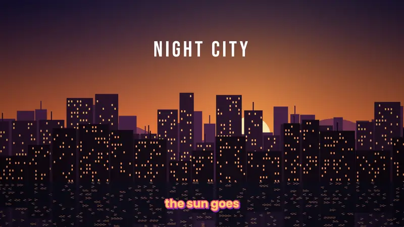

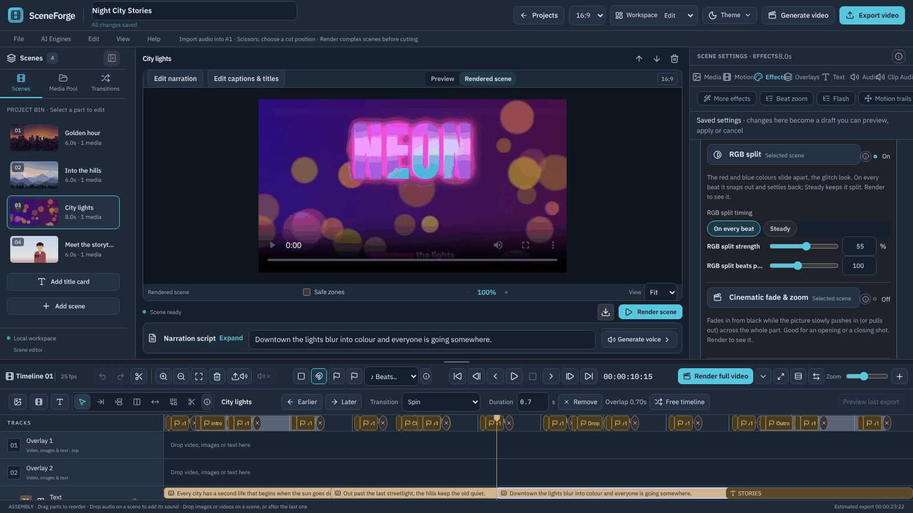

Short-video effects after CapCut's 2026 trend list, all rendered by FFmpeg on your computer.

- **More effects → Trending** *(0.9.4)*: Beat zoom (a punch-in on every beat), Flash (white flash at the start or on the beat), Motion trails, Mirror (halves or a four-corner kaleidoscope), **RGB split** (on the beat or held), **Cinematic fade & zoom**, **Intro move** (swipe left, right or up, spin, zoom), **Before & after** (a white line sweeps across revealing the real picture) and **Speed blur** (the "velocity" look, or a whoosh at the start). Each has its own settings and joins the effect stack, look presets and search.
- **Transitions** *(0.9.4)*: Whip pan left and right, Spin, Zoom punch, Glitch, Cinematic zoom fade, and Before & after, next to the classic dissolves, wipes and slides. Hover one to preview it. Each export keeps its exact length.
- **Looks** *(0.9.4)*: Y2K, Cozy, and Clean & bright, with their own sliders.
- Speed ramps (including a "bullet" velocity ramp) and slow motion for video clips are under **Motion → Speed**; beat markers and **Sync scene cuts to the beat** are on the timeline and in Finishing.

## Editor and timeline

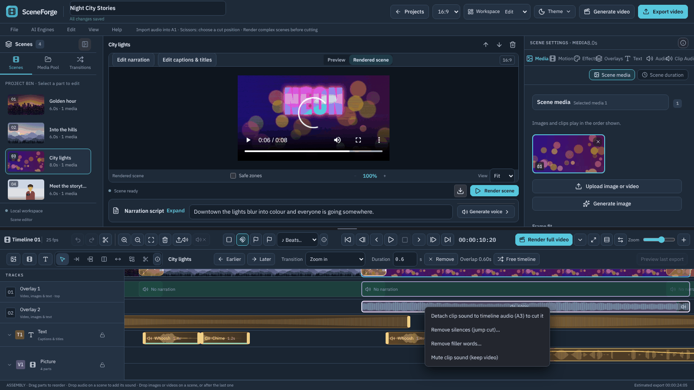

- **Tracks.** T1 holds captions and titles. V1 holds the scene pictures, with transitions overlapping. A1 holds the accepted narration, A2 the embedded sound of each video clip, and **A3–A8** independent audio clips. A whole-project **music bed** sits underneath. Each audio track has **mute, solo and lock**, and is dimmed when it will not be heard. *(A4–A8: 0.7.0)*
- **Edit tools** for timeline audio *(0.7.0)*:

  | Key | Tool |
  |---|---|
  | V | Select |
  | A | Track select forward |
  | B | Ripple trim |
  | N | Roll |
  | Y | Slip |
  | U | Slide |
  | C | Blade |
  | Shift+C | Razor All |

  Delete removes only the selected piece. Shift+Delete ripple-deletes it. Ctrl+C, Ctrl+X, Ctrl+V and Ctrl+D also work, and every edit can be undone.
- **Markers** are saved with the project. A marker can be a point or a range, in five colours, and can be **attached to a clip** so it moves with the clip. **♪ Beats…** finds the beat of the music bed or of a selected clip and marks every beat, every 2nd beat or every bar. Cuts and clips snap to the beat markers. *(0.7.0)*
- **Volume envelopes** take up to 32 keyframes on an A3–A8 clip, with presets such as *dip under a voice*. The line is drawn on the clip and heard in scene renders and in the export. **Clip groups** select and move together: Ctrl+G groups, and Ctrl+Shift+G ungroups. *(0.7.0)*
- **Right-click menus** for audio clips, scenes, narration and clip sound. From these menus you can split, duplicate, move a clip to another track, add a marker to the clip, or **detach narration or clip sound to A3** so you can cut it. *(0.7.0)*
- Everything that existed before: drag-and-drop of files and whole folders, 35 curated transitions with live previews (7 of them trending, see above), split and ripple delete, multi-select with batch apply, snapping, linked trimming of source video and audio, Ctrl+wheel zoom around the pointer, and undo/redo.
- The design notes are in [`docs/TIMELINE_ARCHITECTURE.md`](TIMELINE_ARCHITECTURE.md). V1 is still scene-based. Upper Overlay tracks accept independent video, image and text clips that can span scenes. V1 remains scene-based; nested sequences are not implemented.

## Captions and text

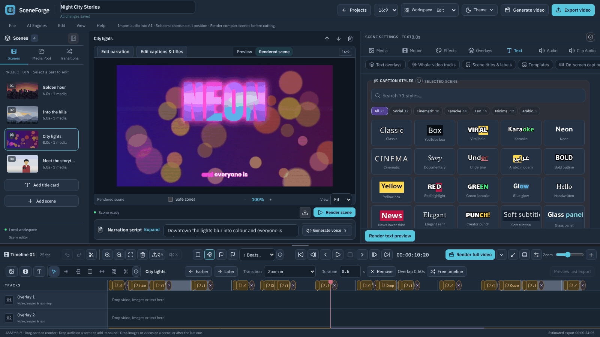

- **71 caption styles** in the groups Social, Cinematic, Karaoke, Fun, Minimal and Arabic, with search *(0.7.0: 40 new)*. You can also set the font, colours, outline, shadow, box, position, phrase or word-by-word splitting, karaoke highlighting and animation.
- **Automatic captions** from narration or video sound:
  - **Local Faster-Whisper** (the `base` model, about **145 MB**) downloads once on first use. After that it runs offline on the CPU, with no key.
  - ElevenLabs Scribe and OpenAI Whisper are optional cloud services.
  - A *Check local captions* panel diagnoses and repairs the local engine.
- **Title layers** (Text, Text Box, Text+) take more than 25 animations. The reveal set includes from-right, up, down, split, **clock wipe**, **counter-clockwise clock** and **iris** *(the last three: 0.7.0)*. There are also typewriter text with sound and per-letter and per-word animations.
- Arabic is rendered right-to-left, with Arabic caption styles and fonts (Noto Naskh, Amiri, Tajawal and Lalezar).

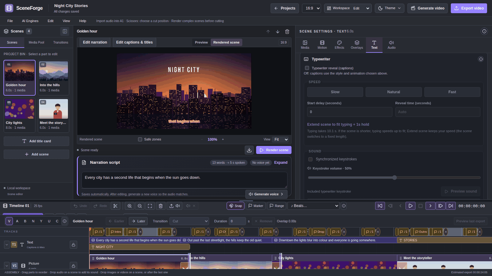

- **Typewriter box** *(0.9.0)*: the caption typewriter, its speed and timing, and its keystroke sound (included or your own recording) in one place, with **Preview sound**. Also new: caption **translation to English** or bilingual captions, and **title templates** (lower third, intro, outro, chapter, quote).

## Effects and looks

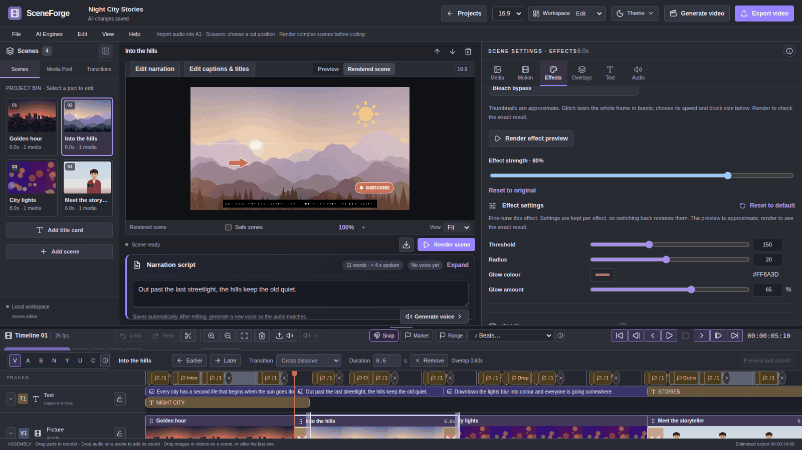

- **Per-effect settings** *(0.7.0)*. 36 presets have 132 settings between them. Examples are warmth, tint and fade for colour looks; bleed, noise, scanlines and tracking for VHS; and threshold, radius and colour for halation. Settings are remembered per effect, and default settings render exactly as before.
- **Looks:** 35 scene looks and film treatments, 11 colour filters (Golden hour, Arctic, Portra film, Y2K, Cozy, Clean & bright and others), and Chromatic split and Motion trail. **Effects pack** *(0.7.0)*:
  - camera shake presets, lens flare and wiggle;
  - focus blur, tilt-shift and mosaic;
  - halation, 2383-style print, tungsten night and cross-process.

  All of these are rendered by FFmpeg. None of them are AI.
- **Colour tools:** sliders, colour wheels, split toning, `.cube` LUT import (3D, 1D and Resolve shaper LUTs), old film, spotlight, light leaks, and blur or pixelate to hide faces.

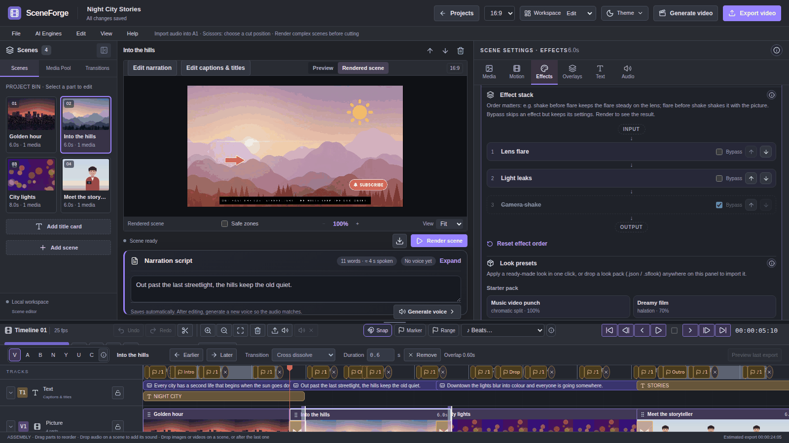

- **Effect stack** *(0.7.0)*. Spotlight, light leak, lens flare, wiggle and camera shake can be reordered or bypassed. The order changes the look: shake before flare keeps the flare steady on the lens.
- **Look preset packs** *(0.7.0)*:
  - Save the current look as a preset.
  - Drag a `.json` or `.sflook` pack onto the Effects tab to import it.
  - Export your own presets as a pack.
  - An 8-preset Starter pack is included.

  See [`docs/EFFECTS_GUIDE.md`](EFFECTS_GUIDE.md).

## Stickers, titles and cutout

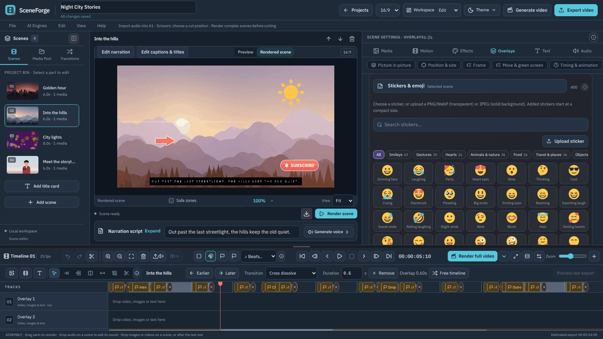

- **400 stickers and emoji** in 14 categories, with search and a Recent tab *(0.7.0)*. 322 are colour emoji from **Twemoji** (CC-BY 4.0). 78 are graphics drawn for SceneForge: subscribe and like buttons, badges, stamps, arrows, callouts, shapes and speech bubbles. The library is bundled, so it looks the same on every computer. Stickers can loop with float, bob or pendulum motion.
- **Picture-in-picture**, split-screen layouts, animated map routes, 3D photo (parallax), Ken Burns, restoration of old photos, and animated annotations. These were already in earlier releases.

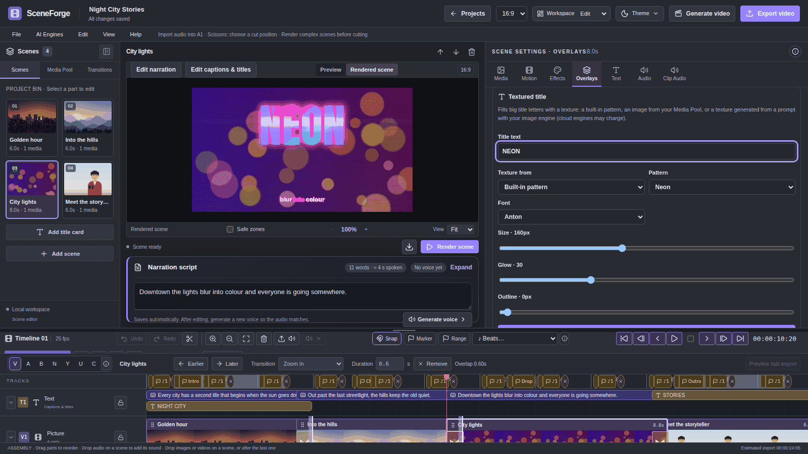

- **Textured titles** *(0.7.0)* fill big letters with a texture. The texture can be one of 9 built-in patterns (lava, neon, gold, chrome, marble, ice, fire, pixel blocks, galaxy), any image in your Media Pool, or a texture generated from a prompt by your image engine. Cloud image engines may charge for that. Titles support glow, outline, 8 fonts and Arabic.

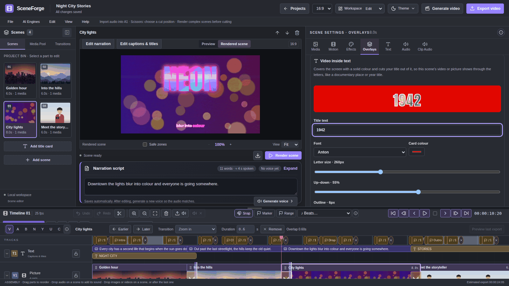

- **Video inside text** *(0.9.1)*: a solid colour card with your title cut out of it, so the scene's video or picture plays inside the letters (the documentary "1942" / place-name look). Colour, opacity, font, size, position and an outline are adjustable.

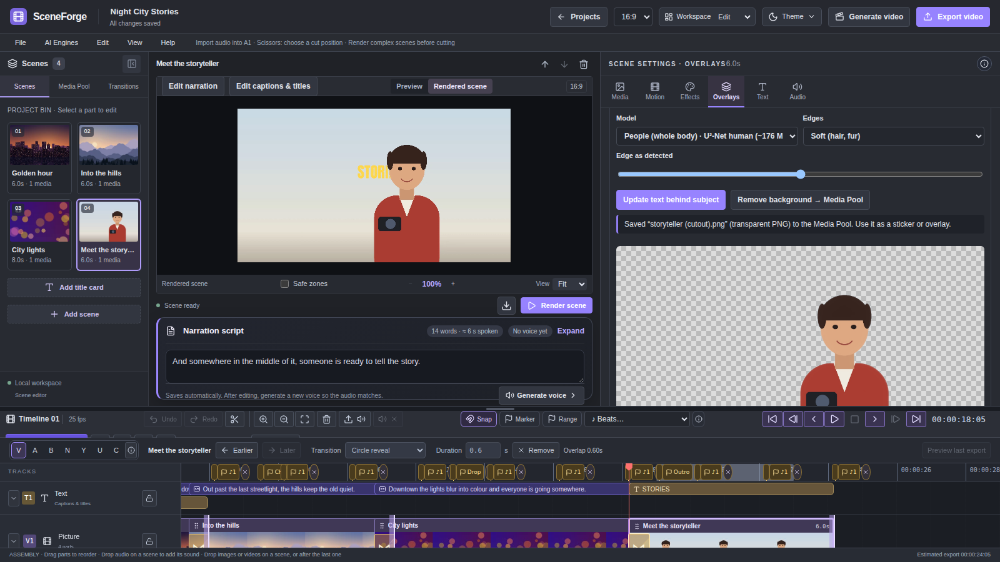

- **Subject cutout (AI, beta)** *(0.7.0)* runs locally with onnxruntime. It has two uses:
  - **Put text behind subject:** captions and titles pass behind a person or object.
  - **Remove background → Media Pool:** saves a transparent PNG.
- Cutout options:
  - Edge refinement, a ±10 px edge grow/shrink, and a result preview on a checkerboard.
  - Models: **U²-Net small** (~4.6 MB, bundled with the installer), **IS-Net** (~170 MB, best general quality) and **People** (U²-Net human, ~176 MB). The two larger models download once, on first use, and are checked against a checksum.
  - **Moving-video cutout** works on one clip of up to 20 s, with a static camera and normal speed. It renders a VP9 alpha layer in the background, with progress and Cancel.

## Audio

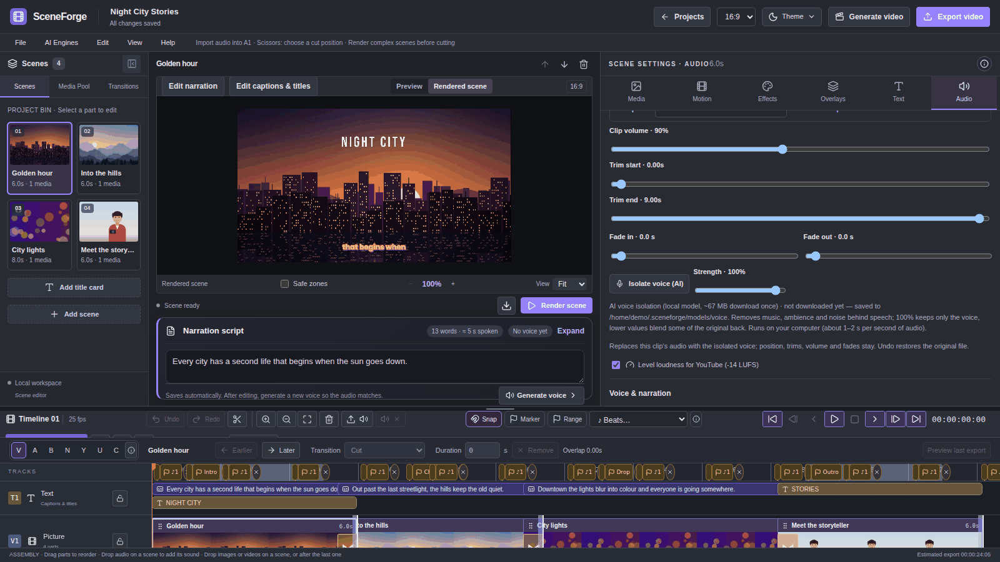

- **AI voice isolation** *(0.7.0)* uses a local MDX-Net model (Kim_Vocal_2, **~67 MB**, downloaded once and checked against a checksum). It is available for narration takes, timeline clips and video clip sound. A strength slider controls it, and your original files are never changed. In a synthetic test it raised voice SDR from 0 to 7.75 dB.
- **Dialogue cleanup** (noise reduction, not AI), **1940s radio** and **telephone** voice effects, and trim, volume, fades and waveform editing for narration.

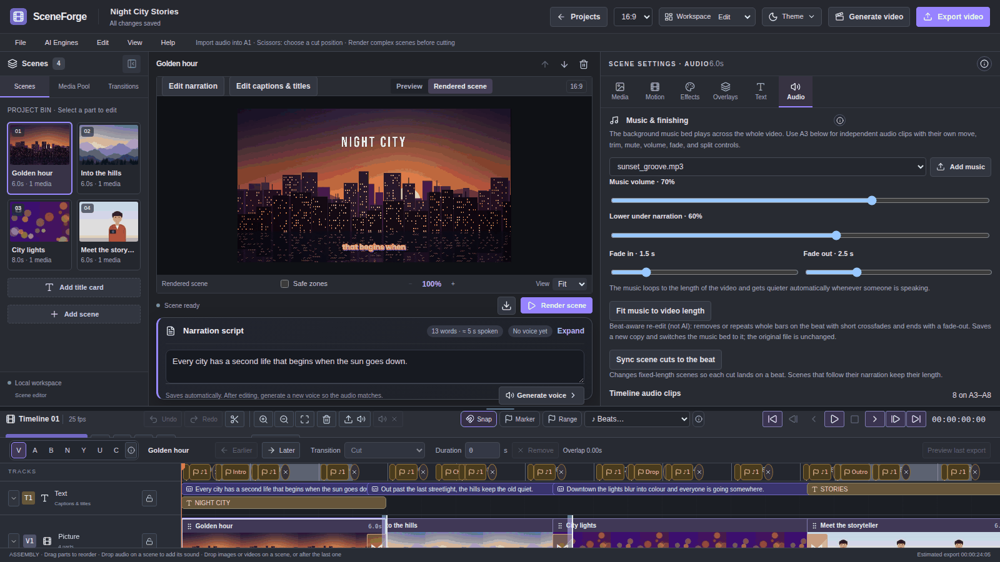

- The **music bed** loops and **ducks under narration** automatically.
- **Fit music to video length** *(0.7.0)* is a beat-aware re-edit, not AI. It removes or repeats whole bars.
- **Sync scene cuts to the beat**, **loudness levelling for YouTube (−14 LUFS)** and a film countdown leader are also available.
- When you play a rendered scene, you also hear the timeline audio and the music under it. The rendered part itself stays clean, so the export mixes each clip only once.

## AI generation (optional)

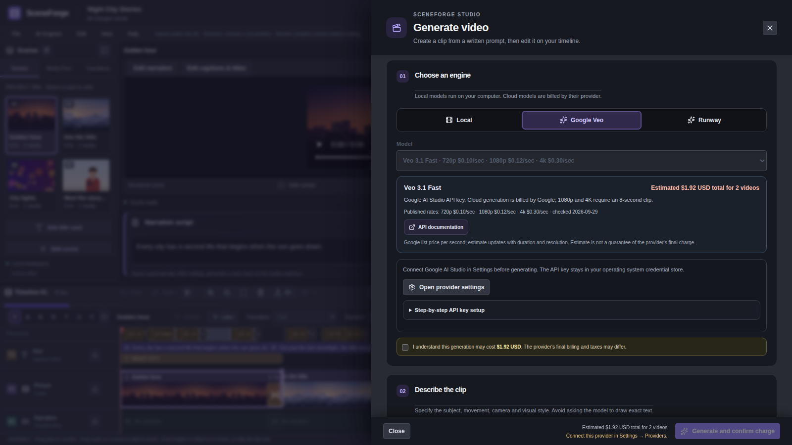

- **Text-to-video.** Run local ComfyUI workflows (LTX-2.5 Fast, Wan 2.1 T2V 1.3B, Wan 2.2 TI2V 5B, Wan 2.2 T2V A14B, or a custom API-format workflow), or use **Google Veo 3.1** or **Runway** (Gen-4.5, WAN 3.0) with your own key. A step-by-step setup guide and an optional GPU/VRAM check help you choose a local model.
- **Cost control.** Cloud requests show the provider's published per-second price and an estimated total for the 1–3 takes you request. Generation starts only after an explicit cost confirmation, which both the UI and the backend check. You can compare the finished takes and add the one you choose to a scene.
- **Image Studio** generates 1–3 options with OpenAI, Google Gemini, Cloudflare Workers AI, Hugging Face, or local Stable Diffusion (AUTOMATIC1111).
- ComfyUI, model weights, custom nodes and workflow files are **not** bundled or downloaded by SceneForge. Prices and models are listed in [AI providers and prices](AI_PROVIDERS.md).

## Local AI: voices, images and captions

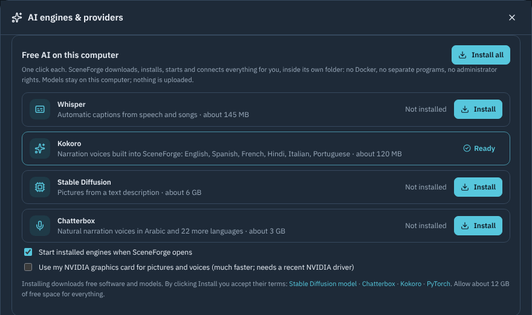

- **One-click setup** *(0.9.4)*: **AI Engines → Free AI on this computer** installs Whisper (captions), Kokoro, Stable Diffusion (pictures) and Chatterbox (voices) into SceneForge's own folder. A setup screen shows progress and you can keep working. Tick **Use my NVIDIA graphics card** for speed; it is chosen automatically when an NVIDIA driver is found.
- **Kokoro** is built into SceneForge (0.9.4-beta.3): English, Spanish, French, Hindi, Italian and Portuguese voices that run on the CPU. **Download voices** fetches about 120 MB once; no Docker, no account.
- **Chatterbox** (Arabic and 22 more languages) installs with one click in **AI Engines**. SceneForge sets up a private Python inside its own folder and runs the voice engine there: no Docker, no administrator rights. The first setup downloads about 3 GB.
- **Gemini voices** (cloud): 100+ languages including Arabic with a free Google AI Studio key. **Voicebox**: if you use the free Voicebox app, SceneForge can use its voices while it is open.
- **Cloud voices:** ElevenLabs (with exact word timing), Gemini voices and Together AI. You can also upload your own recordings.
- Engines set up with 0.9.4-beta.2 or earlier in Docker Desktop keep working.

## Export and share

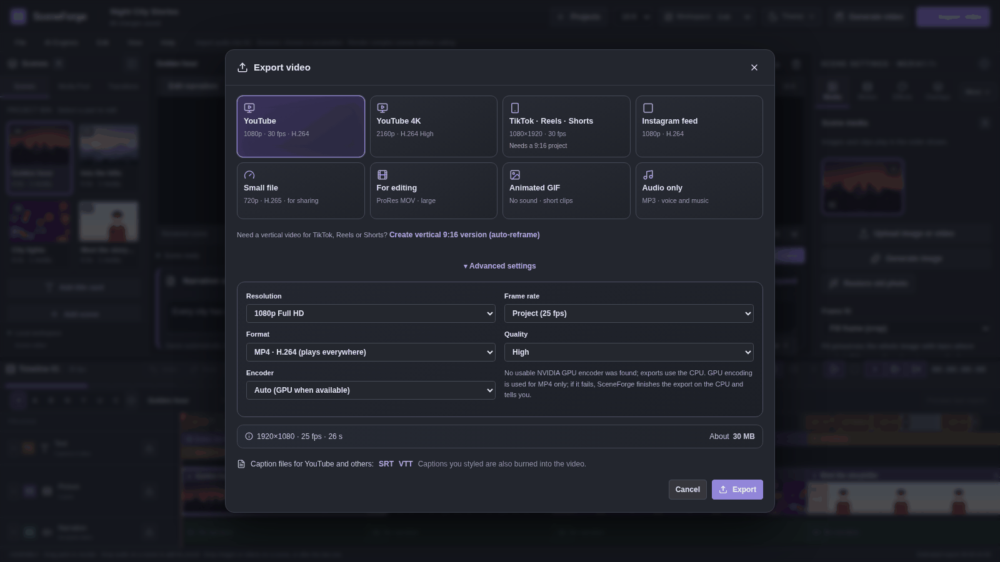

- Platform presets: YouTube (1080p and 4K), TikTok/Reels/Shorts (needs a 9:16 project), Instagram, a small H.265 file, ProRes for editing, animated GIF, and audio only.
- Advanced settings: resolution up to 4K, frame rate, format (MP4/H.264, H.265, WebM, ProRes, GIF, MP3, WAV) and quality.
- **SRT/VTT** caption files are exported alongside the burned-in captions. The sound of each video clip is kept and can be adjusted per clip.
- The **Share** dialog is local-first. It offers a download, opens the file's folder in the desktop app, and gives upload steps for YouTube, TikTok, Instagram and Facebook. It does not upload to your accounts.

## Preferences and themes

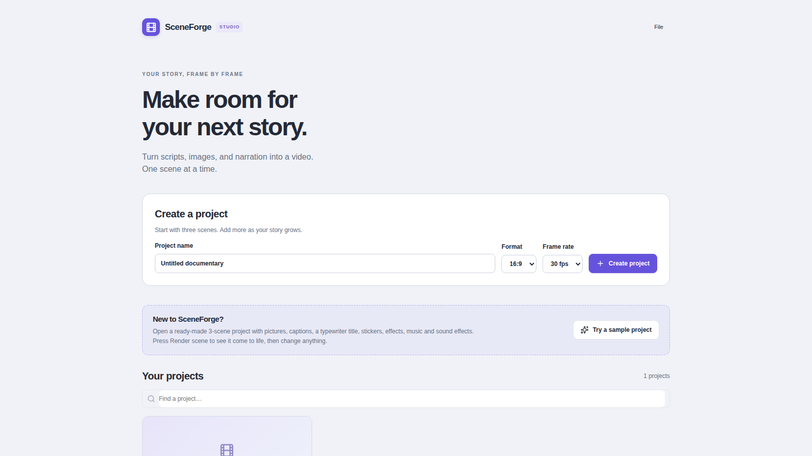

- Themes: **Graphite Night** (the default), **Daylight**, **Midnight Blue** and **Warm Studio**. Preferences are under **File → Preferences** and include an accent colour, panel spacing and reduced motion. The theme menu is also at the top right of the editor.
- You set the project format (16:9, 9:16, 1:1) and frame rate in **Create project**.
- The desktop close dialog offers Save, Don't save, Save and exit, and Cancel.
- Projects live in your user folder. The database is backed up automatically before a new version opens it (**Help → Open project backups**, last 5 kept).
